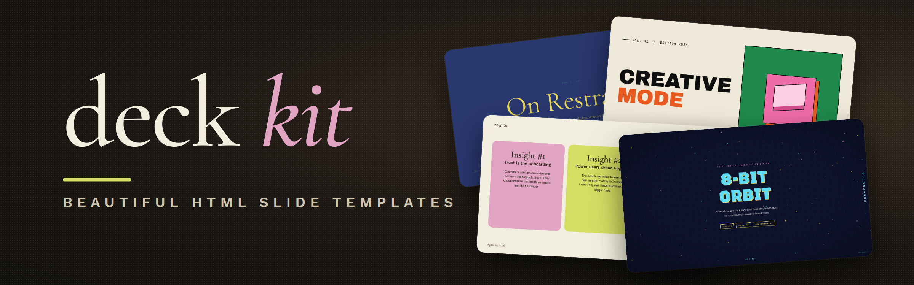

<a id="top"></a>

<div align="center">

# deck-kit



**34 designed HTML slide templates with built-in presenter tools, for building talks with a coding agent.**

[](LICENSE)
[](https://github.com/awun0105/deck-kit/actions/workflows/test.yml)

[Tiếng Việt: README.md](README.md)

</div>

https://github.com/user-attachments/assets/8f2b865c-e0fa-4fd2-a6bd-7b78446f8669

---

## Table of Contents

- [Overview](#overview)
- [Screenshots](#screenshots)
- [Key Features](#key-features)
- [Repository Structure](#repository-structure)
- [Getting Started](#getting-started)
- [Advanced Usage](#advanced-usage)
- [Contributing](#contributing)
- [Acknowledgement](#acknowledgement)
- [License](#license)

---

## Overview

deck-kit lets you build HTML presentations with a coding agent such as Claude Code, Codex or Gemini CLI. Describe the talk: the agent picks one of 34 templates, writes the slides and speaker notes, and hands back one HTML file. Open it in a browser to present — no PowerPoint, no internet needed.

## Screenshots

<p>
  
  
  
  
  
  
</p>

<details>
<summary><b>All 34 templates</b></summary>

All 34 templates, three slides each (cover · mid-deck · later). Click a name to open its folder.

### [Soft Editorial](./templates/soft-editorial/)

<p>
  
  
  
</p>

> Cormorant Garamond serif on warm paper with sage, blush, and lemon accents.

### [Editorial Forest](./templates/editorial-forest/)

<p>
  
  
  
</p>

> Forest green, dusty pink, and warm cream in Source Serif 4 — quiet, intentional quarterly-review aesthetic.

### [Pin & Paper](./templates/pin-and-paper/)

<p>
  
  
  
</p>

> Yellow paper with safety-pin illustrations, ink-blue handwritten Caveat, paper-grain texture.

### [Sakura Chroma](./templates/sakura-chroma/)

<p>
  
  
  
</p>

> Vintage Japanese cassette-package aesthetic: cream paper, diagonal rainbow ribbons, condensed bold type, JIS-style spec checkboxes.

### [Stencil & Tablet](./templates/stencil-tablet/)

<p>
  
  
  
</p>

> Bone paper with stencil-cut headlines and a six-color earth palette: archaeology meets brand.

### [Cobalt Grid](./templates/cobalt-grid/)

<p>
  
  
  
</p>

> Electric cobalt italic serifs on a graph-paper canvas, anchored by stair-stepped pixel-glitch decorations and slim hairline rules.

### [Vellum](./templates/vellum/)

<p>
  
  
  
</p>

> Deep navy canvas with warm-yellow italic Cormorant serifs and a single dusty teal accent. A quiet, scholarly aesthetic.

### [Emerald Editorial](./templates/emerald-editorial/)

<p>
  
  
  
</p>

> Magazine-cover business deck: emerald + navy + paper with double-rule masthead ornaments and a heavy Bodoni-style display serif.

### [Neo-Grid Bold](./templates/neo-grid-bold/)

<p>
  
  
  
</p>

> Editorial neo-brutalism with a single neon yellow accent on off-white paper.

### [Editorial Tri-Tone](./templates/editorial-tri-tone/)

<p>
  
  
  
</p>

> Three-color editorial system: dusty pink, mustard cream, and deep burgundy, set in Bricolage + Instrument Serif.

### [Creative Mode](./templates/creative-mode/)

<p>
  
  
  
</p>

> Cream paper canvas with confident multi-color (green, pink, orange, yellow) accents and Archivo Black display.

### [Monochrome](./templates/monochrome/)

<p>
  
  
  
</p>

> Ivory ledger paper with all-black type; Lora serif headlines, Jost body, no color at all.

### [People's Platform (Block & Bold)](./templates/peoples-platform/)

<p>
  
  
  
</p>

> Activist poster energy: blue, orange, red on cream, with Alfa Slab + Caveat Brush.

### [Pink Script — After Hours](./templates/pink-script/)

<p>
  
  
  
</p>

> Black canvas, hot pink accent, pearl-cream paper, Instrument Serif headlines: late-night editorial luxury.

### [8-Bit Orbit](./templates/8-bit-orbit/)

<p>
  
  
  
</p>

> Pixel-art neon arcade aesthetic on a deep navy void.

### [BlockFrame](./templates/block-frame/)

<p>
  
  
  
</p>

> Neobrutalist deck with pastel-neon color blocks and chunky black borders.

### [Blue Professional](./templates/blue-professional/)

<p>
  
  
  
</p>

> Cream paper background with electric cobalt blue accents; clean modern professional.

### [Bold Poster](./templates/bold-poster/)

<p>
  
  
  
</p>

> Editorial poster aesthetic with massive Shrikhand display and a single fire-engine red accent.

### [Broadside](./templates/broadside/)

<p>
  
  
  
</p>

> Dark editorial canvas with a single fire orange accent and bilingual Latin/Chinese type stack.

### [Capsule](./templates/capsule/)

<p>
  
  
  
</p>

> Modular pill-shaped cards on warm bone with a full pastel-pop palette.

### [Cartesian](./templates/cartesian/)

<p>
  
  
  
</p>

> Quiet warm-neutral palette with classical Playfair serifs; tasteful and unhurried.

### [Coral](./templates/coral/)

<p>
  
  
  
</p>

> Cream and coral on near-black, set in oversized Bebas Neue.

### [Daisy Days](./templates/daisy-days/)

<p>
  
  
  
</p>

> Cheerful pastel deck with hand-drawn daisies, stars, and rainbows. Friendly, soft, and warm.

### [Grove](./templates/grove/)

<p>
  
  
  
</p>

> Forest-green canvas with cream type, classical Playfair serifs, and a single rust accent.

### [Mat](./templates/mat/)

<p>
  
  
  
</p>

> Dark sage canvas with bone paper and burnt-orange accent; mid-century modern with wood undertones.

### [Playful](./templates/playful/)

<p>
  
  
  
</p>

> Sun-warm peach background with Syne display: a friendly indie launch deck.

### [Raw Grid](./templates/raw-grid/)

<p>
  
  
  
</p>

> Neo-brutalist deck with thick borders, offset shadows, and a pink/sage/ink palette.

### [Retro Windows](./templates/retro-windows/)

<p>
  
  
  
</p>

> Windows 95 chrome: gray title bars, MS Sans Serif, pixel typography, full nostalgia.

### [Retro Zine](./templates/retro-zine/)

<p>
  
  
  
</p>

> Beige paper with green accent and Bebas Neue + Caveat: a riso-printed zine in HTML form.

### [Scatterbrain](./templates/scatterbrain/)

<p>
  
  
  
</p>

> Post-it inspired: pastel sticky notes, Caveat handwriting, Shrikhand and Zilla Slab type stack.

### [Signal](./templates/signal/)

<p>
  
  
  
</p>

> Deep navy canvas with bone paper and a single muted-gold accent; institutional with quiet weight.

### [Studio](./templates/studio/)

<p>
  
  
  
</p>

> Black canvas with electric-yellow type; high-voltage design studio aesthetic.

### [Biennale Yellow](./templates/biennale-yellow/)

<p>
  
  
  
</p>

> Solar yellow on warm parchment with deep indigo serif and atmospheric sun-glow gradients. Dutch-editorial poster energy.

### [Long Table](./templates/long-table/)

<p>
  
  
  
</p>

> Warm cream and rust-red supper-club aesthetic with bold uppercase grotesk headlines, italic Fraunces, and pill-shaped outlined buttons.

</details>

## Key Features

- **Presenting:** presenter view on the laptop (next slide, notes, timer), laser pointer, drawing, zoom into a region.
- **Interactive slides:** step reveals, maths, highlighted code, quizzes, charts, video — each is one HTML attribute.
- **Editing in the browser:** move, resize and retype, then save straight into the file.
- **Import and export:** Markdown or PowerPoint to deck; deck to PDF, PowerPoint or a shareable link.

## Repository Structure

| Path | Description |
|---|---|
| `templates/` | The 34 templates, one self-contained folder each |
| `runtime/` | The presenter toolkit `deck-kit.js`, shared by every template |
| `scripts/` | Commands to create, import, check, export and publish decks |
| `examples/deck-kit-demo/` | A deck showing every feature |
| `AGENTS.md` | The full guide for agents (also `SKILL.md`) |

## Getting Started

You need Node.js 18+ and Google Chrome (Chrome is used to check and export decks; any browser can present).

### 1. Install

In Claude Code, install the plugin:

```text
/plugin marketplace add awun0105/deck-kit
/plugin install deck-kit@deck-kit
```

With other agents, clone the repository and start the agent inside the `deck-kit` folder (it reads `AGENTS.md`):

```bash
git clone https://github.com/awun0105/deck-kit.git
cd deck-kit && npm install
```

Open `examples/deck-kit-demo/index.html` to see what deck-kit can do.

### 2. Make a deck

Ask your agent, for example:

> Use deck-kit to make me a 20-minute deck about Kalman filters for my class.

The agent asks a few questions, shows three template previews, then builds the deck. To work by hand (template names are the folders in `templates/`):

```bash
node scripts/new-deck.mjs vellum ~/slides/kalman       # from a template
node scripts/md-to-deck.mjs outline.md --theme=vellum  # from Markdown
node scripts/pptx-to-deck.mjs talk.pptx --theme=vellum # from PowerPoint
```

### 3. Present

Open the deck's `index.html` in a browser. The keys you'll use most:

| Key | Action |
|---|---|
| `←` `→` | Navigate and reveal steps |
| `P` | Presenter view (second window) |
| `N` / `T` | Notes / timer |
| `L` / `D` / `Z` | Laser / draw / zoom |
| `E` | Edit in place; press again to save |
| `?` | All shortcuts |

## Advanced Usage

- **Interactive slides:** every attribute, with examples, is in [widgets-reference.md](widgets-reference.md). Usually it's enough to ask the agent, e.g. "add a quiz at the end of part 2".
- **Precise changes through the agent:** press `K`, click the element to copy its location, and paste it into the chat with what to change.
- **Export and share:** press `X` in the deck to print a PDF or get ready-made commands, or run:

  ```bash
  node scripts/export.mjs ~/slides/kalman/index.html --pdf --pptx
  node scripts/deploy.mjs ~/slides/kalman/index.html --to=vercel   # or cloudflare, github
  ```

  A published deck is public; speaker notes are left out of it.

Every other command and option is described in [AGENTS.md](AGENTS.md), sections 8 and 9.

## Contributing

Report bugs and ideas in [GitHub Issues](https://github.com/awun0105/deck-kit/issues). For pull requests, edit the runtime only in `runtime/`, then run `npm run sync` and `npm test`.

## Acknowledgement

deck-kit grew out of Zara Zhang's [beautiful-html-templates](https://github.com/zarazhangrui/beautiful-html-templates) (MIT; the 34 designs come from the original project), with ideas from [frontend-slides](https://github.com/zarazhangrui/frontend-slides) (MIT) and [ai-deck-builder](https://github.com/Faris-Alanazi/ai-deck-builder) (MIT).

## License

MIT — see [LICENSE](LICENSE).

---

<div align="center">

[Back to Top](#top)

</div>
